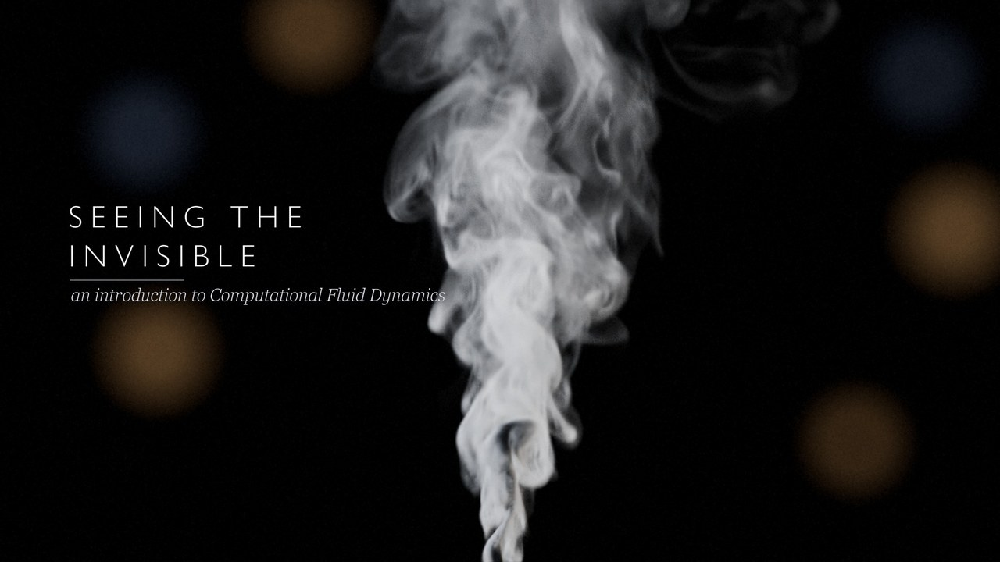
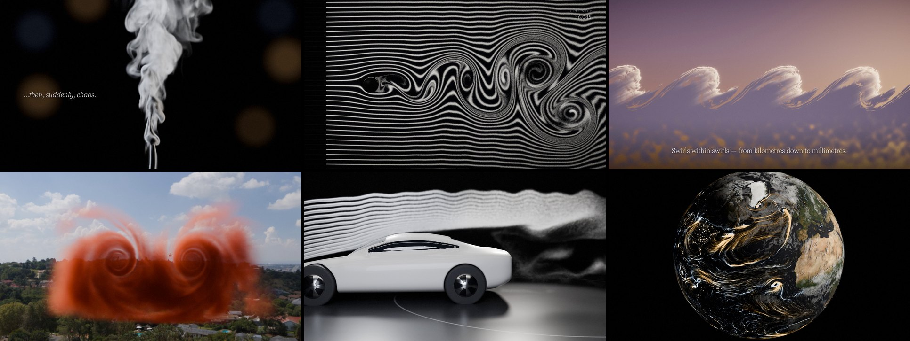

# Seeing the Invisible — a short film about Computational Fluid Dynamics



A 2 min 35 s cinematic introduction to **Computational Fluid Dynamics (CFD)** for a general audience:
no voiceover, just on-screen captions and an original score. It shows *why* fluids are hard (Navier–Stokes,
turbulence), the core idea of CFD (cut space into cells → keep the balance in every cell → march in time),
and where it is used (aircraft, cars, offshore wind, weather, blood flow).

Almost everything you see is a **real simulation run for this film**: lattice-Boltzmann and vortex-method solvers
written from scratch in Python + [NVIDIA Warp](https://github.com/NVIDIA/warp) on one consumer GPU, rendered in
Blender (Cycles/Eevee) and composited by code. The music is synthesised in numpy. There's no stock footage.



| Time | Act | Content |
|------|-----|---------|
| 0:00 | Wonder | Incense smoke, laminar → turbulent (3D LBM, 192×384×192) · title |
| 0:20 | The rules | Navier–Stokes, term by term |
| 0:43 | The idea | Mesh grows around a car · one cell's balance · a von Kármán vortex street emerges (2D LBM, 74 k steps) · coarse vs fine grids |
| 1:27 | Turbulence | Kelvin–Helmholtz wave clouds (2D LES 3840×2160) · RANS / LES / DNS |
| 1:47 | Everywhere | Wing-tip vortices (Krasny vortex method) · car in a wind tunnel (3D LBM) · offshore wind · real NOAA GFS winds · blood flow |
| 2:20 | Close | The smoke is scanned into its CFD twin · end title |

Shot-by-shot details (and which shots are genuine simulations vs. illustrations): [docs/MAKING_OF.md](docs/MAKING_OF.md).

The rendered film (≈ 436 MB, 1080p24 H.264) is not stored in git; rebuild it with the pipeline below.

## Repository layout
```
src/       solvers (lbm2d.py, lbm3d.py, particles3d.py), 2D shots, SDF models, music.py, timeline.py, compose.py
blender/   Blender scene/render scripts for the 3D shots (+ the .blend files they save)
assets/    third-party inputs, each with its SOURCE/LICENSE note (HDRIs, NASA Earth imagery, NOAA GFS winds)
tools/     GPU job queue, render checker, probes and tests
docs/      storyboard, making-of, progress log, open questions
```
Generated data (`cache/`, `renders/`, `audio/*.wav`, `output/`) is git-ignored and fully regenerable.

## Rebuilding the film
Requirements: Windows, an NVIDIA GPU (developed on an RTX 4070 SUPER, 12 GB), Python 3.13, Blender 5.2.
Rendering everything takes about a night on that GPU.

```bash
python -m venv .venv && .venv/Scripts/pip install -r requirements.txt
export BLENDER_EXE="C:/path/to/blender.exe"       # default: D:\Tools\Blender\blender.exe
```
1. **2D shots** (run from `src/`): `shot_s03_equations.py all`, `shot_s06_vortex_street.py`, `shot_s07_resolution.py`,
   `shot_s08_kh.py`, then `shot_s09_models.py`.
2. **Preparation for the 3D shots** (from `src/`): `car_sdf.py mesh`, `plane_sdf.py`, `sim_car_mask.py`, `mesh_s04.py`,
   `sim_wing.py`, `shot_s13_wind.py`, `artery.py`.
3. **Simulations inside Blender**: `blender -b --factory-startup --python blender/sim_incense.py` and `blender/sim_car.py`
   (Warp is imported from the venv inside Blender).
4. **Renders**: `blender -b --factory-startup --python blender/shot_<name>.py -- <SHOT> <first> <last> ...`
   (exact commands per shot in [docs/PROGRESS.md](docs/PROGRESS.md)). `tools/gpu_queue.sh` runs a list of GPU jobs
   one after another, and `tools/check_renders.py` reports any frames still missing.
5. **Music**: `src/music.py` → `audio/score.wav`.
6. **Edit**: `src/compose.py` (add `--draft` for a half-resolution preview, or `--still T` for one frame) →
   `output/Seeing_the_Invisible_CFD.mp4`; `src/make_srt.py` writes EN / 简体中文 subtitle files.

Fonts: the captions use Windows fonts (Gill Sans Nova Light, Georgia Pro Light) from `C:\Windows\Fonts`. They are
not redistributed here, so substitute your own in `src/common.py`.

## Licence
- **Code** (`src/`, `blender/*.py`, `tools/`): [MIT](LICENSE).
- **Original media**: the film, its music, renders and `.blend` scenes are licensed under
  [CC BY 4.0](https://creativecommons.org/licenses/by/4.0/). Credit "Seeing the Invisible — EdtRhyn".
- **Third-party assets** keep their own terms (see the notes next to them):
  Poly Haven HDRIs ([CC0](https://polyhaven.com/license)); NASA Blue Marble / Black Marble imagery (public domain, credit NASA);
  NOAA/NCEP GFS forecast data (public domain, U.S. Government work).

`CLAUDE.md` and `docs/PROGRESS.md` / `docs/QUESTIONS.md` are working notes from making the film with Claude Code.
